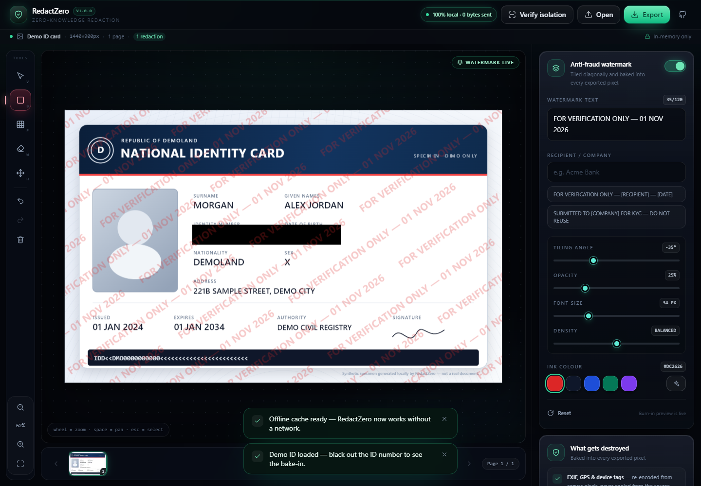
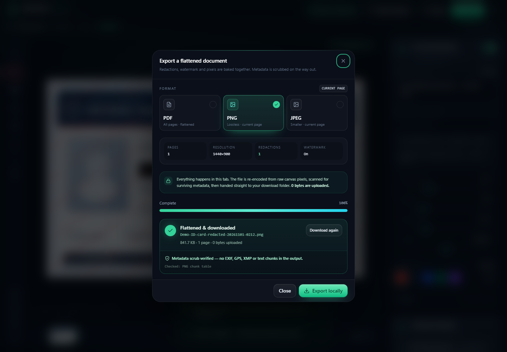
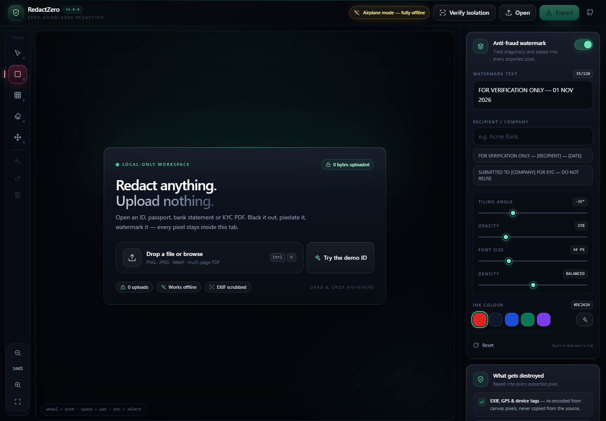

<div align="center">


# RedactZero

**Zero-knowledge ID & KYC document redaction — 100% in your browser.**

Redact. Watermark. Flatten. Nothing ever leaves your device.

[](LICENSE)
[](https://github.com/jamamjadalone/redact-zero/actions/workflows/quality.yml)
[](#security-model)
[](#security-model)
[](#progressive-web-app)
[](#progressive-web-app)
[](https://vite.dev)
[](https://www.typescriptlang.org)

[**Live app**](https://jamamjadalone.github.io/redact-zero/) · [Report a bug](https://github.com/jamamjadalone/redact-zero/issues) · [Verify isolation](https://jamamjadalone.github.io/redact-zero/?action=verify)

</div>

---



<p align="center">
  
  
</p>

## Why RedactZero?

Every day, people send photographs of passports, national ID cards, utility bills and bank
statements to landlords, employers, crypto exchanges and "verification" portals. Those copies
are stored on servers you do not control, forwarded through inboxes, indexed by backups, and
eventually leaked. A single unredacted ID is enough to power SIM-swap attacks, loan fraud and
full identity theft.

Most "free online redaction" tools make the problem worse: they **upload the original
document** to a server, draw a box on a copy, and hand back a file whose hidden text layer,
metadata and original uploads still exist somewhere. Some PDF "redactions" are just black
rectangles layered on top of selectable text — anyone can drag them away.

**RedactZero takes the opposite approach.** The entire pipeline — decoding, rendering,
redacting, watermarking, re-encoding — runs in your browser tab. There is no backend, no
account, no analytics, no remote fonts and no network requests. The app ships with a
Content-Security-Policy that blocks outbound connections and a runtime tripwire that counts
any attempt to make one.

- **No uploads.** Files are read from disk into memory with the File API.
- **No accounts.** There is nothing to sign up for and nothing to store.
- **No telemetry.** Not even crash reporting. The counter in the header should stay at `0`.
- **No hidden layers.** Exports are rasterised; redactions become opaque pixels.
- **No EXIF.** Camera model, GPS, timestamps and software tags are destroyed by re-encoding.
- **Works offline.** Install it once as a PWA and it keeps working with Wi-Fi switched off.

## Features

### Redaction tools
- **Solid blackout** — irreversible opaque rectangles for ID numbers, dates of birth, signatures and addresses.
- **Pixelate / mosaic** — downsample-and-rebuild mosaic that cannot be sharpened back into text.
- **Sanitizing whiteout** — clean white boxes for light-background documents.
- **Select & resize** — annotations stay editable vectors until you export: move, resize or delete any box, with eight-point handles.
- **Undo / redo / clear** — full history across every page, with keyboard shortcuts.

### Anti-fraud watermarking
- Tiled diagonal watermark burned into the exported pixels, so a leaked copy can be traced to the recipient.
- Three presets: `FOR VERIFICATION ONLY — [SERVICE] — [DATE]`, `SUBMITTED TO [COMPANY] FOR KYC — DO NOT REUSE`, or fully custom text.
- Live controls for angle, opacity, font size, density and ink colour.
- Preview is pixel-identical to the export.

### Documents & export
- PNG, JPEG and multi-page PDF input (drag-and-drop or file picker).
- Multi-page PDFs render at 2× DPI for crisp text and a thumbnail page navigator.
- Export flattened **PNG** (lossless), **JPEG** (quality slider) or a rebuilt **PDF** where every page is a single raster image — no selectable text, no annotations, no original metadata.
- Post-export byte scan reports whether any EXIF / XMP / PNG text chunk / PDF author field survived.
- Everything is keyboard- and touch-friendly, with mouse/touch coordinate mapping that survives zoom and pan.

## How it works

```
┌─────────────┐    ┌──────────────┐    ┌───────────────┐    ┌──────────────┐
│ File API    │ →  │ Canvas 2D    │ →  │ Vector boxes  │ →  │ Flatten      │
│ (local disk)│    │ + pdf.js     │    │ + watermark   │    │ + re-encode  │
└─────────────┘    └──────────────┘    └───────────────┘    └──────────────┘
                                                                   │
                                                     PNG / JPEG / PDF blob
                                                                   │
                                                            Download only
```

1. **Ingest** — images are decoded with `createImageBitmap` (EXIF orientation applied, then discarded); PDFs are rasterised page-by-page with `pdfjs-dist` at 2× scale.
2. **Annotate** — boxes are stored as plain vector objects in source-pixel coordinates, so zooming and panning never affects the final result.
3. **Composite** — each export draws the source, applies blackout/whiteout fills or re-samples a mosaic, then tiles the watermark on top.
4. **Flatten** — the composite is a new canvas; there are no layers to remove.
5. **Re-encode** — `canvas.toBlob()` (or `pdf-lib` for PDFs) produces a brand-new file containing only pixels. Source metadata cannot survive this step.
6. **Verify** — the exported bytes are scanned for metadata markers before the file is handed to your download folder.

## Quick start

**Requirements:** Node.js 20+ and npm.

```bash
npm install
npm run dev
```

Open the URL printed by Vite. The app is served under `/redact-zero/` by default so it matches
GitHub Pages project sites:

```
http://localhost:5173/redact-zero/
```

Production build and local preview:

```bash
npm run build     # type-check + Vite build + service worker generation
npm run preview
```

Regenerate the PWA icons (no native image tooling required):

```bash
npm run icons
```

## Quality gates

`npm test` builds the app, then runs two independent suites. Both run in CI on every
push to `main` and every pull request ([`quality.yml`](.github/workflows/quality.yml)),
and the deploy workflow refuses to publish if either suite fails.

```bash
npm test          # pretest build → repo audit → browser smoke test
npm run test:repo # static audit only (fast, no browser)
npm run test:smoke # end-to-end browser test against dist/
```

**Repository audit** (`tests/repo-quality.test.mjs`) — zero dependencies, pure Node:

- **Structure** — required source, PWA, docs and workflow files are all present.
- **Package hygiene** — exactly two runtime dependencies, no install hooks, no
  analytics/telemetry packages, lockfile resolves only from `registry.npmjs.org`.
- **Security invariants** — CSP directives, no inline scripts, no remote URLs outside
  `src/config.ts`, no `fetch`/`XHR`/`sendBeacon`/`WebSocket` in app code, no `eval`,
  no console logging, no `TODO`/`FIXME`.
- **PWA** — manifest fields, icon files whose real pixel dimensions match their declared
  sizes, maskable icon, shortcuts, and consistent theme colours across HTML and manifest.
- **Docs** — README sections, badges and screenshot links resolve; MIT license; no
  committed secrets; no repository file over 2 MB.
- **Build budget** — self-contained `dist/` with no source maps, bundled pdf.js worker,
  ≥ 15 precached assets, < 4 MB total, main JS < 600 KB, CSS < 90 KB.
- **UI contract** — the stable element IDs the smoke test drives still exist.

**Browser smoke test** (`tests/smoke.test.mjs`) — headless Chrome over the DevTools
protocol against the real production build, served from a temporary static server:

1. Boots with the CSP enforced, one `h1`, no horizontal overflow.
2. Loads the synthetic demo ID, switches tools, draws a redaction, undoes and redoes it.
3. Exports a flattened PNG **and** PDF, waits for real download files, and asserts the
   metadata scrub report.
4. Opens the isolation dialog and asserts the tripwire counter is `0` and the displayed
   policy matches the enforced policy verbatim.
5. Fails on **any** cross-origin request, failed asset, or console error.
6. Reloads through the service worker, goes fully offline, and renders the demo again.

The browser suite skips gracefully when Chrome is unavailable (set `CHROME_PATH`) or the
Node runtime has no built-in `WebSocket` (Node 22+ is required). Failures write a
screenshot to `test-results/`, which CI uploads as an artifact.

## Deploy to GitHub Pages

This repository ships with a ready-to-run workflow at
[`.github/workflows/deploy.yml`](.github/workflows/deploy.yml).

1. Push the repository to GitHub.
2. Go to **Settings → Pages** and set **Source** to **GitHub Actions**.
3. Push to `main`. The workflow runs `npm ci && npm test` (audit + build + browser smoke
   test) and only publishes `dist/` when every gate passes.
4. Your app appears at `https://<user>.github.io/redact-zero/`.

### Deploying somewhere else

The base path is controlled by `VITE_BASE`:

```bash
# root domain (e.g. Netlify, Vercel, Cloudflare Pages)
VITE_BASE=/ npm run build

# custom sub-path
VITE_BASE=/tools/redact/ npm run build
```

Update `id`, `start_url`, `scope` and icon paths in [`public/manifest.json`](public/manifest.json)
if you rename the repository or mount it under a different path.

## Progressive Web App

- `vite-plugin-pwa` generates the service worker (`registerType: 'autoUpdate'`).
- All JS, CSS, HTML, icons and the pdf.js worker are precached — including the offline PDF path.
- Hand-written [`public/manifest.json`](public/manifest.json): standalone display, dark theme,
  maskable icon, app shortcuts.
- Install it from Chrome/Edge ("Install app") or Safari ("Add to Home Screen").

## Security model

| Claim | How it is enforced |
| --- | --- |
| No uploads | No backend exists. Files are read via `File`/`Blob` and never passed to `fetch`. |
| No telemetry | No analytics, no error reporting, no remote fonts, no third-party scripts. |
| No outbound connections | CSP `connect-src 'self'` blocks them at the browser level. |
| Network tripwire | `fetch`, `XMLHttpRequest` and `sendBeacon` are wrapped to count cross-origin attempts; the header badge shows the count. |
| Metadata destruction | Every export is re-encoded from canvas pixels. The exported bytes are scanned for EXIF/XMP/text chunks. |
| Irreversible redaction | Boxes are composited into the bitmap before encoding. Exported PDFs contain one raster image per page — no text layer, no annotations. |
| No server-side state | Nothing is stored except your in-memory session. Refreshing clears it. |

### Verify it yourself

1. Open DevTools → **Network** and clear the list.
2. Drop a PDF or photo and draw a blackout box.
3. Export. Watch the request list — there is no upload and no third-party call.
4. Turn off Wi-Fi and repeat; the installed PWA keeps working.

### Honest limitations

- **Pixelation is a visual control, not a cryptographic guarantee.** For maximum safety use the
  solid blackout on highly sensitive fields.
- **PDFs are rasterised**, so exported PDFs are larger than the original and text is no longer
  selectable or searchable. This is intentional: it destroys hidden text layers.
- **Memory-bound.** Very large multi-page PDFs are rendered at 2× and held in memory; on older
  phones, prefer splitting large documents first.
- **Watermarks deter casual reuse** but do not prevent a determined attacker from cropping them.
- **Your device is the trust boundary.** A compromised browser or malicious extension can still
  read what is on screen. RedactZero removes the server from the equation, not the endpoint.

## Tech stack

| Layer | Choice |
| --- | --- |
| Build | Vite 6 + TypeScript (strict) |
| Styling | Tailwind CSS 3, custom dark "cyber-minimalist" design system |
| PDF input | `pdfjs-dist` (worker-based, 2× rendering) |
| PDF output | `pdf-lib` (flattened raster pages, neutral metadata) |
| PWA | `vite-plugin-pwa` / Workbox |
| Icons | Hand-authored inline SVG (zero icon-font payload) |
| Runtime deps | `pdfjs-dist`, `pdf-lib` — nothing else |

## Project structure

```
redact-zero/
├── .github/workflows/
│   ├── deploy.yml                 # build + test + GitHub Pages publish
│   └── quality.yml                # audit and browser gates on push / PR
├── public/
│   ├── favicon.svg
│   ├── icon-192.png · icon-512.png · icon-maskable-512.png
│   ├── apple-touch-icon.png
│   ├── manifest.json
│   └── robots.txt
├── scripts/generate-icons.mjs     # dependency-free PNG rasteriser
├── src/
│   ├── components/
│   │   ├── CanvasEditor.ts        # zoom/pan/draw/resize engine
│   │   ├── ExportModal.ts         # format picker, progress, metadata report
│   │   ├── Header.ts              # brand, isolation badge, actions
│   │   ├── IsolationModal.ts      # "prove it" walkthrough
│   │   ├── Modal.ts               # accessible <dialog> wrapper
│   │   ├── PageNavigator.ts       # thumbnail strip
│   │   ├── ToolBar.ts             # tools, history, zoom
│   │   └── WatermarkControls.ts   # watermark + guarantees panel
│   ├── utils/
│   │   ├── canvasRenderer.ts      # mosaic + flatten pipeline
│   │   ├── demoDocument.ts        # synthetic specimen ID
│   │   ├── dom.ts
│   │   ├── exifCleaner.ts         # JPEG/PNG/PDF metadata scanner
│   │   ├── exporter.ts            # PNG/JPEG/PDF assembly
│   │   ├── icons.ts
│   │   ├── networkGuard.ts        # outbound request tripwire
│   │   ├── pdfHandler.ts          # pdf.js ingestion + image decoding
│   │   ├── toast.ts
│   │   └── watermarkGenerator.ts  # cached tiled watermark layer
│   ├── app.ts
│   ├── config.ts
│   ├── main.ts
│   ├── state.ts                   # store + undo/redo history
│   ├── style.css
│   └── types.ts
├── index.html                     # CSP + PWA meta
├── tests/
│   ├── repo-quality.test.mjs      # dependency-free repository audit
│   └── smoke.test.mjs             # headless-Chrome end-to-end gates
├── vite.config.ts
└── README.md
```

## Legal & privacy disclaimer

RedactZero is a privacy tool, not a legal service. It is designed to support **data
minimisation** under the GDPR (Article 5(1)(c)), the UK GDPR, CCPA/CPRA and comparable
frameworks: share only the fields a recipient genuinely needs.

- You are responsible for verifying that a redacted document is safe before you send it.
- Redaction quality depends on the tool you choose: use blackout for anything highly sensitive.
- No tool can guarantee that a recipient will not misuse a document. Watermarking and
  minimisation reduce risk; they do not eliminate it.
- RedactZero is provided **"as is"**, without warranty of any kind. See [LICENSE](LICENSE).
- Nothing here is legal advice.

## Contributing

Issues and pull requests are welcome. Please keep the zero-network promise intact: any change
that adds a third-party request, remote font, analytics call or backend dependency will be
rejected.

```bash
npm install
npm run dev      # http://localhost:5173/redact-zero/
npm test         # audit + build + browser smoke test (required before a PR)
```

## License

[MIT](LICENSE) © 2026 jamamjadalone
